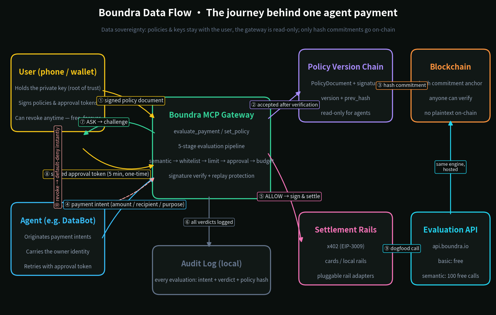

# Boundra · Payment approval gateway for AI agents

<!-- mcp-name: io.boundra/boundra -->

> **Boundra** (boundra.io) — *Boundaries for agent payments.*
> The boundary layer for agent payments: before any money moves, answer
> "should this payment happen at all?"

Our thesis: **the opportunity in agent payments is not "how to pay" (protocols
solved that) but "whether to pay."**

One natural-language rule → compiled into a policy → every payment the agent
attempts is genuinely evaluated → allow / ask a human / veto, with a full
audit trail.

Two run modes:

- **Offline simulation** (`demo.py`): stdlib only, self-contained mock merchant
  and wallets, zero dependencies, zero network
- **Real protocol** (`demo/demo_real.py`): standard MCP server + real x402 SDK +
  Base Sepolia testnet

## Data flow



Policies and keys stay with the user; the gateway is read-only; only hash
commitments go on-chain. Revocation is free — forever, no exceptions.

> **Integrating Boundra into your agent?** See
> [docs/INTEGRATION.md](docs/INTEGRATION.md) — hosted API, x402 SDK hook,
> and MCP paths with tested code.

## See it run in 60 seconds

```bash
# 1. Hit the hosted evaluation API — a real, public x402 merchant
curl -X POST https://api.boundra.io/evaluate/basic \
  -H 'Content-Type: application/json' \
  -d '{"intent":{"amount":0.01,"recipient":"api.weather.com","purpose":"weather data"}}'
# → {"decision":"ALLOW",...}  ·  semantic layer: 100 free calls per agent,
#   then $0.003 via x402 — settled for real on Base mainnet (USDC)

# 2. Local end-to-end simulation — a data-procurement agent's day
.venv/bin/python demo/simulate_agent.py
# signed policy publish → ALLOW / DENY (limit) / ASK → user-signed approval token
# → prompt-injection blocked → audit trail, plus a dogfood call to api.boundra.io

# 3. One-line MCP install + 2-minute policy wizard
uvx --from git+https://github.com/gobeyondfj-cmd/boundra boundra-mcp     # stdio server
uvx --from git+https://github.com/gobeyondfj-cmd/boundra boundra-init    # wallet → template → sign → anchor
uvx --from git+https://github.com/gobeyondfj-cmd/boundra boundra-approve # sign an ASK challenge
```

## The complete flow, step by step

Zero to a signed, enforced policy in ~10 minutes. No accounts, no dashboards —
your wallet key is your identity.

**0 · Try the hosted API** *(30 seconds, nothing to install)*

```bash
curl -X POST https://api.boundra.io/evaluate/basic \
  -H 'Content-Type: application/json' \
  -d '{"intent":{"amount":0.01,"recipient":"api.weather.com","purpose":"weather data"}}'
```

**1 · Bind your identity — the wallet is the account**

```bash
uvx --from git+https://github.com/gobeyondfj-cmd/boundra boundra-init
```

Creates or imports a Base wallet. No signup, no email — the private key never
leaves your device, and your address *is* your identity everywhere in the
system.

**2 · Set your policy**

The wizard offers templates (personal assistant / travel / dev API /
procurement) or lets you write your own rule in plain English, then compiles
it and shows you exactly what will be enforced — before anything is signed.

**3 · Sign & publish**

You sign the policy document with your wallet key (EIP-191). It is published
as a versioned document and a hash commitment is anchored on-chain. From this
moment the gateway is read-only for every agent — changing the policy without
your key is impossible.

**4 · Mount the MCP server into your agent**

Hosted (zero install, multi-tenant, default-deny until you publish a signed
policy):

```json
{ "mcpServers": { "boundra": { "url": "https://api.boundra.io/mcp" } } }
```

Or self-hosted:

```json
{ "mcpServers": { "boundra": { "command": "uvx",
  "args": ["--from", "git+https://github.com/gobeyondfj-cmd/boundra", "boundra-mcp"] } } }
```

**5 · Every payment gets a verdict before signing**

Your agent calls `evaluate_payment`; the 5-stage pipeline answers
**ALLOW** (sign & settle) / **DENY** (aborted pre-signature, zero on-chain
trace) / **ASK** (a challenge bound to this exact payment).

**6 · When the agent asks, you decide**

```bash
uvx --from git+https://github.com/gobeyondfj-cmd/boundra boundra-approve
```

Paste the ASK challenge, sign it on your device — the agent retries with the
signed approval token. Forged, rebound, or replayed tokens are rejected.

**7 · Watch, update, revoke**

`get_spend_report` / `get_audit_trail` / `get_policy_versions` keep you in
control day to day. Every policy change is a new signed version
(`set_policy`); `revoke_policy` is instant default-deny and **free forever**.

## Quick start (from source)

```bash
cd boundra

# Mode 1: offline simulation (run this first — the full flow in 30 seconds)
python demo/demo.py

# Mode 2: real x402 + MCP
python -m venv .venv && .venv/bin/pip install \
    "x402[evm,httpx]" mcp eth-account fastapi uvicorn
.venv/bin/python tests/test_mcp_client.py    # MCP protocol-level tests
.venv/bin/python demo/setup_wallets.py       # generate Base Sepolia test wallets + faucet guide
.venv/bin/python demo/demo_real.py           # real protocol end-to-end (settles on-chain after funding)
```

## Architecture: where the gateway stands

```
Agent framework (Claude / custom)
   │  MCP protocol (stdio)
   ▼
mcp_server.py  ──→  policy.py 5-stage evaluation pipeline
(policy decision     semantic → whitelist → limit → approval → budget
 point)
   ▲
   │ on_before_payment_creation hook (x402 SDK v2 native interception point)
x402_buyer.py ──sign (EIP-3009)──→ x402 server ──→ facilitator ──→ Base Sepolia
```

**Key finding**: x402 SDK v2 natively provides the `on_before_payment_creation`
hook plus `register_policy` / `set_spend_controls` — the policy layer is not a
bolt-on; it is the slot the official protocol stack reserves. This validates
the wedge.

## File map

```
boundra/
├── policy.py                 intent compilation (NL→Policy, bilingual CN/EN) + 5-stage pipeline + platform red lines
├── signed_policy.py          ★ signed policy documents + version chain + revocation (keccak)
├── approval.py               ★ signed approval tokens (challenge → user signs → gateway verifies)
├── mandate.py                ★ task Mandates: single-use authorization, burned after use (pipeline layer 4)
├── templates.py              ★ policy template library (personal assistant / travel / dev API / procurement)
├── chain_anchor.py           ★ anchor backends: local simulation + real Base Sepolia (web3)
├── gateway.py                gateway core v3: 4-layer stacking + token verification + Mandate + revocation
├── rail_adapters.py          ★ rail adapter layer: evaluation core decoupled from settlement rails (x402 first)
├── mcp_server.py             ★ standard MCP server (11 tools, stdio)
├── boundra_cli.py            ★ boundra-init (policy wizard) + boundra-approve (challenge signer)
├── contracts/
│   └── PolicyAnchor.sol      ★ on-chain commitment contract (owner-write, anyone-read)
├── demo/
│   ├── simulate_agent.py     ★ end-to-end user journey simulation (MCP + hosted API dogfood)
│   ├── demo_policy.py        signed-policy demo (impersonation / unsigned / tampering attacks all blocked)
│   ├── demo_real.py          real-protocol end-to-end orchestration
│   ├── x402_resource_server.py  real x402 paywall server (FastAPI middleware)
│   ├── x402_buyer.py         real x402 buyer, evaluated by the MCP gateway before signing
│   ├── setup_wallets.py      Base Sepolia test wallet generation
│   └── demo.py / merchant.py / agent.py   offline simulation (zero dependencies)
├── tests/
│   ├── test_product.py       ★ product tests (22 assertions)
│   └── test_mcp_client.py    MCP protocol-level tests
├── docs/
│   ├── dataflow.png          data-flow diagram (English)
│   └── render_*.py           diagram renderers (architecture / flow / use-case / data flow)
└── state/audit.jsonl         audit trail (generated at runtime, gitignored)
```

## Signed policies: the root of trust is the user's key, not the gateway's database (v2)

A policy is a **document signed by the user's wallet**, not a row in the
gateway's configuration:

```
user private key signature ──→ PolicyDocument (NL rule + compiled artifact + prev_hash + version)
                      │  three checks: signer == owner, versions sequential, prev_hash unbroken
                      ▼
              PolicyStore (version chain) ──→ LocalAnchor (simulated commitment; production writes to contract)
                      │
                      ▼  check_integrity before every evaluation (signature + anchor)
              5-stage pipeline; audit records cite policy version + hash
```

- **Read-only for agents**: without the user's private key, `set_policy` always
  fails — impersonation, unsigned, and tampered submissions are all blocked
  (seven scenarios in `demo/demo_policy.py`)
- **Two stacked scopes**: user-level (rules for all agents) × agent-level
  (per-agent rules); the strictest verdict wins
- **Every version bump is a signature**: v2 must reference v1's hash; tampering
  with any historical version → signature invalid + chain broken
- **Privacy shape**: only hash commitments go on-chain; policy plaintext never
  leaves the device unless the user chooses to disclose

Run: `.venv/bin/python demo/demo_policy.py`

## MCP server tools

| Tool | Purpose | Caller |
|------|---------|--------|
| `evaluate_payment` | Pre-payment evaluation. ALLOW proceeds / DENY aborts / **ASK** returns a challenge the user signs; retry with `approval_token` | Agent |
| `set_policy` | **Privileged**: submit a new policy version; requires the owner's EIP-191 signature | User only |
| `revoke_policy` | **Privileged**: revoke a policy chain (default-deny immediately, free forever) | User only |
| `get_policy_versions` | Policy version history (chain + hashes, comparable with on-chain commitments) | Anyone |
| `get_policy` | View the legacy fallback policy | Anyone |
| `get_spend_report` | Today's spend / remaining budget | Agent |
| `get_audit_trail` | Approval audit records | Agent |
| `request_policy_change` | Agent asks the user for a policy change (queued, never self-applied) | Agent |
| `list_templates` / `render_template` | Policy template helpers | Agent |

### Mount into Claude Desktop

One line — uvx resolves dependencies and starts the server:

```json
{
  "mcpServers": {
    "boundra": {
      "command": "uvx",
      "args": ["--from", "git+https://github.com/gobeyondfj-cmd/boundra", "boundra-mcp"]
    }
  }
}
```

On first run, use the **`boundra-init`** wizard (same package): create/import a
wallet → pick a policy template → sign → publish via MCP, about 2 minutes.
When your agent hits ASK, run **`boundra-approve`** and paste the challenge to
produce a signed approval token.

## ⚠️ Known trust-boundary simplifications (must fix for production)

1. ~~`human_approved` self-attested by the agent~~ **solved (v3)**: human
   approval is now a signed approval token (approval.py) — ASK returns a
   challenge bound to the exact payment intent; the user's device signs it;
   the gateway verifies signature + field-by-field intent match + nonce
   replay protection. The legacy self-attested path remains but is tagged
   `approve(legacy-deprecated)`.
2. **MCP-level interception is advisory** — an agent framework can bypass the
   gateway and talk to the wallet directly. Mitigation: pair with x402's
   native hook (demonstrated in `demo/demo_real.py`; the hook fires inside the SDK,
   before signing). Endgame: compile the deterministic parts of policy into a
   smart-contract wallet module, enforced at the settlement layer.
3. **Semantic detection is regex-based** — production should swap in LLM
   evaluation + intent anchoring.
4. **Anchoring defaults to a local log** — the real contract
   (`contracts/PolicyAnchor.sol`) and web3 client (`chain_anchor.BaseSepoliaAnchor`)
   are ready; set `chain_config.json` to switch to the real chain (deploy via
   Remix with test ETH).

## Economic model: the evaluation API is itself an x402 merchant

Tiered pricing:

| Operation | Price |
|-----------|-------|
| Deterministic evaluation (`/evaluate/basic`) | Free |
| Semantic evaluation (`/evaluate/semantic`) | 100 free calls per agent; then $0.003 USDC/call (real x402 charge) |
| Policy anchoring / revocation | Free (revocation is free forever — a safety red line) |

Open core: the client, evaluation engine, and demos in this repo are
Apache-2.0. The hosted evaluation service (tiered pricing, free-quota
accounting, revenue ledger) runs from the private `boundra-ops` repo.

## Verified / not yet verified

**Verified** (all of `test_product.py` 22 assertions + `test_mcp_client.py` pass):
4-layer policy stacking (platform red lines × user × agent × Mandate) with
strictest-wins; signed approval tokens (valid passes, forged rejected,
intent-rebinding rejected, replay rejected); Mandate single-use; revocation
defaults to deny and a signed v2 restores; template render+compile; all MCP
tools over the wire; gateway blocks an injection attack inside the real x402
402 round-trip before the SDK signs; the full tiered-pricing loop — first
proven on Base Sepolia (2026-10-16), then on **Base mainnet (2026-10-21)**:
free tier passes, paid tier settles $0.003 USDC for real (buyer 1.010 → 1.007,
platform address credited 0.003), dogfood hook self-evaluates, semantic layer
blocks the injection, `/revenue` ledger entry.
The mainnet settlement tx is publicly verifiable: [`0xf04d3497…4eac7e5`](https://basescan.org/tx/0xf04d3497626c7eea675440eefd037da22ac400ca874daf8e90564ca124eac7e5)
— the live API now settles on Base mainnet via Coinbase's CDP facilitator.
Earlier testnet proof: [`0x5ad8ef4b…c474bbe`](https://sepolia.basescan.org/tx/0x5ad8ef4b4d6eef7ba34e718742068f8e8480336c12032a3a85801b101c474bbe)
(the hosted service code is closed by design — the chain is the receipt).

**Not yet verified**: real on-chain anchoring (contract ready, needs test ETH
to deploy); real user demand; semantic layer false-positive rate under real
LLM behavior distributions.
